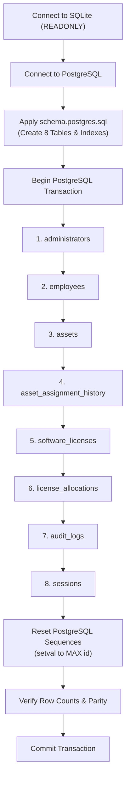

# Database Migration Guide: SQLite to Google Cloud SQL (PostgreSQL)

## 1. Overview & Conversion Rationale

The application was initially developed using **SQLite 3** for rapid offline prototyping. For production deployment on **Google Cloud Run**, the database layer has been abstracted to support **Google Cloud SQL for PostgreSQL 14+**.

Because Cloud Run instances are stateless and ephemeral, a file-based SQLite database on local disk cannot be used in production.

---

## 2. Dialect & Schema Differences Handled

| Feature / Syntax | SQLite Implementation | PostgreSQL (Cloud SQL) Implementation | Handled By |
| :--- | :--- | :--- | :--- |
| **Primary Keys** | `INTEGER PRIMARY KEY AUTOINCREMENT` | `SERIAL PRIMARY KEY` | `schema.postgres.sql` |
| **Current Timestamp** | `DATETIME('now')` | `CURRENT_TIMESTAMP` | Query normalizer in `database.js` |
| **Insert Idempotence** | `INSERT OR IGNORE INTO` | `INSERT INTO ... ON CONFLICT DO NOTHING` | Query normalizer in `database.js` |
| **Query Parameters** | Positional question marks `?` | Numbered parameters `$1, $2, ...` | `convertPlaceholders()` in `database.js` |
| **Insert Return ID** | `this.lastID` (C++ SQLite binding) | `RETURNING id` | Automatic clause appended in `database.js` |
| **String Concatenation** | `first_name \|\| ' ' \|\| last_name` | `first_name \|\| ' ' \|\| last_name` | ANSI SQL (Identical in both) |
| **Foreign Keys** | `PRAGMA foreign_keys = ON` | Native table-level constraints | Enforced by PostgreSQL engine |
| **Table Inspection** | `sqlite_master` | `information_schema.tables` | `HealthRepository` & `migrate.js` |

---

## 3. Pre-Migration Checklist

Before executing the migration:

1. **Local SQLite Backup**: Create a timestamped copy of your SQLite database:
   ```bash
   cp cloud/data/asset_management.db "cloud/data/asset_management_backup_$(date +%Y%m%d_%H%M%S).db"
   ```
2. **Cloud SQL Instance Running**: Confirm Cloud SQL PostgreSQL 14+ instance status is `RUNNABLE`.
3. **Database & User Provisioned**: Ensure database `asset_management` and user `asset_app_user` exist.

---

## 4. Step-by-Step Migration Execution

### Step 1: Connect via Cloud SQL Auth Proxy
Download the proxy for your OS and launch a secure tunnel on standard port 5432:
```bash
# In Terminal 1:
cloud-sql-proxy PROJECT_ID:REGION:INSTANCE_NAME --port 5432
```

### Step 2: Set Environment Variables
In your migration terminal (Terminal 2):
```bash
cd cloud/backend

export DB_HOST="127.0.0.1"
export DB_PORT="5432"
export DB_NAME="asset_management"
export DB_USER="asset_app_user"
export DB_PASSWORD="your_secure_db_password"
```

### Step 3: Run the Migration Tool
```bash
npm run db:migrate-pg
```

---

## 5. Migration Execution Logic & Sequence

The migration utility (`cloud/backend/src/db/migrateSqliteToPostgres.js`) executes the following operations in an atomic transaction:



### Why Sequence Resetting is Essential:
When rows are inserted with explicit primary keys (`id: 1, 2, ...`), PostgreSQL internal auto-increment sequences (`assets_id_seq`, etc.) do not advance automatically. The migration script resets each sequence:
```sql
SELECT setval(pg_get_serial_sequence('"assets"', 'id'), COALESCE((SELECT MAX(id) FROM "assets"), 1));
```
This guarantees that subsequent asset registrations on Cloud Run start at `MAX(id) + 1` without primary key collisions!

---

## 6. Post-Migration Verification & Integrity Checks

The migration tool outputs an integrity report:

```
[Migration Results by Table]:
  - administrators            : SQLite: 1 | PG Total: 1 | Synced: ✓ OK
  - employees                 : SQLite: 5 | PG Total: 5 | Synced: ✓ OK
  - assets                    : SQLite: 6 | PG Total: 6 | Synced: ✓ OK
  - asset_assignment_history  : SQLite: 6 | PG Total: 6 | Synced: ✓ OK
  - software_licenses         : SQLite: 4 | PG Total: 4 | Synced: ✓ OK
  - license_allocations       : SQLite: 8 | PG Total: 8 | Synced: ✓ OK
  - audit_logs                : SQLite: 3 | PG Total: 3 | Synced: ✓ OK
  - sessions                  : SQLite: 0 | PG Total: 0 | Synced: ✓ OK
```

### Manual SQL Verification Commands
You can also connect via `psql` to verify:
```sql
-- 1. Check table row counts
SELECT 'employees' as tbl, count(*) FROM employees
UNION ALL
SELECT 'assets', count(*) FROM assets
UNION ALL
SELECT 'software_licenses', count(*) FROM software_licenses;

-- 2. Verify password hashes are preserved identically
SELECT id, username, email, substring(password_hash, 1, 10) as hash_prefix FROM administrators;

-- 3. Verify custody foreign keys
SELECT a.asset_tag, a.name, e.employee_code, e.first_name || ' ' || e.last_name as assignee
FROM assets a
JOIN employees e ON a.current_employee_id = e.id
WHERE a.status = 'ASSIGNED';
```

---

## 7. Rollback Procedures

Because the SQLite database is opened in **READ-ONLY mode** (`sqlite3.OPEN_READONLY`), the migration script **never alters or deletes local SQLite data**.

If a migration fails or must be rolled back:

1. **Cloud SQL Rollback**:
   The migration runs inside an atomic `BEGIN ... COMMIT` block. If an error occurs midway, all inserts are rolled back automatically.
2. **Clean Reset in Cloud SQL**:
   To drop all tables and re-run cleanly:
   ```bash
   gcloud sql databases delete asset_management --instance=$DB_INSTANCE_NAME --quiet
   gcloud sql databases create asset_management --instance=$DB_INSTANCE_NAME
   ```
3. **Local Development Continuity**:
   Local development continues unaffected using `DB_ENGINE=sqlite` pointing to `data/asset_management.db`.
