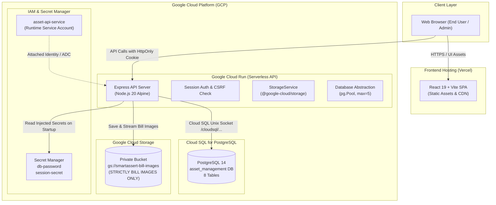
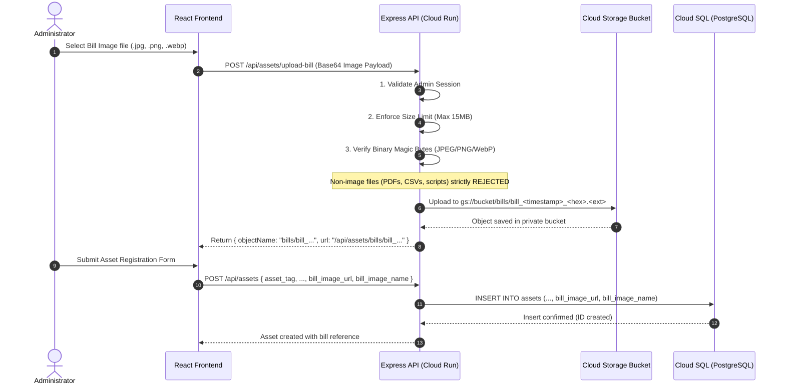
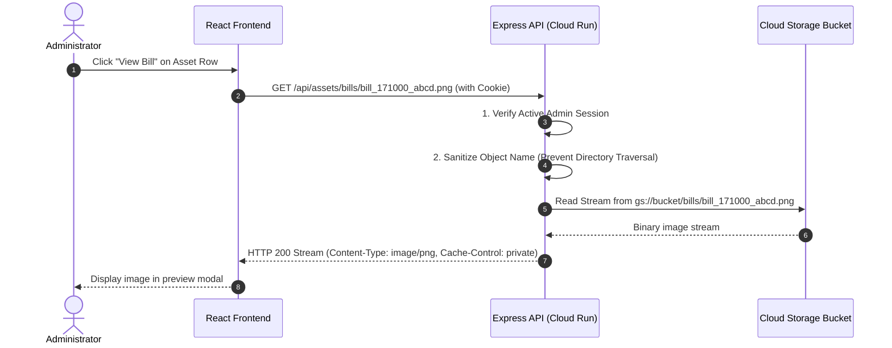

# Google Cloud Architecture & Data Flow Specification

## 1. System Overview

The **smartAssert** IT Asset Lifecycle & Software License Management system integrates Google Cloud Platform (GCP) services to achieve a high-security, serverless, cost-optimized deployment using available trial credits and free allowances.



---

## 2. Component Architecture

| Component | Technology | Role | Deployment Environment |
| :--- | :--- | :--- | :--- |
| **Frontend** | React 19, Vite, Lucide | UI dashboards, lifecycle workflows, bill upload & viewer | Vercel (Global Edge Network) |
| **Backend API** | Node.js 20, Express 4.19 | REST API endpoints, auth, validation, reporting | Google Cloud Run (Container) |
| **Database** | PostgreSQL 14 | Asset metadata, employee custody, licenses, bill image paths | Google Cloud SQL (Managed) |
| **Object Storage** | Google Cloud Storage | User-uploaded purchase bill images **exclusively** | GCS Private Bucket (`bills/*`) |
| **Secret Management**| Google Secret Manager | Database application password, session secret | Cloud Secret Manager |
| **Identity & Access**| GCP IAM | Least-privilege service account permissions | Attached Service Account (`asset-api-service`) |

---

## 3. Detailed Data Flows

### 3.1 Authentication & Session Verification Flow

```mermaid
sequenceDiagram
    autonumber
    actor Admin as Administrator
    participant UI as React Frontend (Vercel)
    participant API as Express API (Cloud Run)
    participant DB as Cloud SQL (PostgreSQL)

    Admin->>UI: Enter Username & Password
    UI->>API: POST /api/auth/login
    API->>DB: Query administrator by username/email
    DB-->>API: Return admin record & bcrypt hash
    API->>API: Timing-safe bcrypt.compare()
    API->>DB: Insert into sessions (id, admin_id, expires_at)
    DB-->>API: Session record saved
    API-->>UI: Set-Cookie: session_id=<token>; SameSite=None; Secure; HttpOnly
    UI-->>Admin: Redirect to Inventory Dashboard
```

1. The administrator submits login credentials over HTTPS.
2. The Express backend verifies credentials against the `administrators` table using bcrypt.
3. A cryptographically random 256-bit opaque session token is generated.
4. The session is persisted in the PostgreSQL `sessions` table.
5. Cloud Run returns an `HttpOnly`, `Secure`, `SameSite=None` cookie.
6. Subsequent requests automatically transmit the session cookie via `credentials: 'include'`.

---

### 3.2 Bill Image Upload Flow (Strict Single-Purpose GCS)



#### Upload Consistency & Failure Handling:
- **Insert Failure Reconciliation**: If image upload to GCS succeeds but the subsequent asset database insertion fails (e.g., tag collision or DB timeout), the backend calls `storageService.deleteBillImage(objectName)` to prevent orphaned files in Cloud Storage.
- **Replacement Safeguard**: When updating an asset with a new bill, the old GCS image is deleted only after the database record update has completed successfully.
- **Asset Deletion**: When an asset is deleted, its associated GCS bill object is automatically deleted from Cloud Storage.

---

### 3.3 Authorized Bill Image Retrieval Flow

The Cloud Storage bucket is **100% private** (`public-access-prevention: enforced`). Unauthenticated or direct public access to Google Cloud Storage URLs is completely blocked.



Alternatively, short-lived signed URLs (15-minute validity) can be obtained via `GET /api/assets/bills/:fileName/signed-url` after administrator authorization.

---

### 3.4 Non-Storage Data Flows (CSV Reports & Documents)

In strict adherence to the project storage boundary:
- **CSV Reports**: Asset Inventory, Assigned Assets, History, and License Utilization CSVs are generated entirely **in-memory** on Cloud Run using streaming transformers and returned immediately as `text/csv` downloads with formula injection sanitization.
- **Reports are NEVER uploaded to Cloud Storage**.

---

## 4. Security & Isolation Matrix

| Layer | Mechanism | Protection |
| :--- | :--- | :--- |
| **Authentication** | Server-persisted sessions in PostgreSQL | Immune to JWT revocation delays; server manages active sessions |
| **Cookies** | `HttpOnly`, `Secure`, `SameSite=None` | Immune to XSS token theft in browser local storage |
| **CSRF Defense** | Strict Origin/Referer matching | Blocks cross-site malicious state changes |
| **Storage Privacy** | Uniform Bucket-Level Access, No Public Access | Bucket files unreachable without Cloud Run authorization |
| **Payload Integrity**| Binary magic-number inspection | Rejects non-image files masquerading as images |
| **Path Traversal** | Basename isolation (`path.basename()`) | Blocks `../` traversal outside `bills/` directory |
| **IAM Isolation** | Attached Service Account | No downloaded JSON private keys stored in container or repo |
| **Secret Management**| Secret Manager runtime injection | Zero secrets committed in code, git history, or Docker images |
